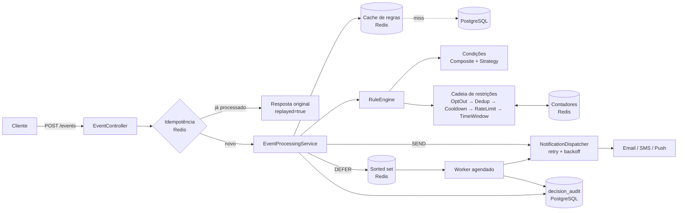

# Motor de Regras para Notificações

Serviço backend que decide **se, quando, por qual canal e para quem** enviar uma notificação, com base em
regras configuráveis em tempo de execução (sem deploy).

**Stack:** Java 21 · Spring Boot 3.5 · PostgreSQL 16 · Redis 7 · Flyway · Docker · Testcontainers

## Como rodar

```bash
docker compose up --build
```

Antes da primeira execução, crie o seu `.env` a partir do modelo e troque as senhas
(o `.env` está no `.gitignore` e nunca deve ser commitado):

```bash
cp .env.example .env      # PowerShell: Copy-Item .env.example .env
```

> **Segurança:** a API não tem autenticação e as portas são publicadas só em `127.0.0.1`.
> Leia [SECURITY.md](SECURITY.md) antes de expor o serviço. Depois de subir:

| O quê | URL |
|---|---|
| API | http://localhost:8080 |
| Swagger UI | http://localhost:8080/swagger-ui.html |
| Saúde | http://localhost:8080/actuator/health |
| Métricas | http://localhost:8080/actuator/metrics/notify.decisions |
| Prometheus | http://localhost:8080/actuator/prometheus |

Duas regras de exemplo são criadas pela migração `V2__sample_data.sql` (`PEDIDO_CRIADO` e `PAGAMENTO_FALHOU`).

### Rodando localmente (sem Docker para a aplicação)

```bash
docker compose up -d postgres redis
DB_PASSWORD=<senha-do-.env> REDIS_PASSWORD=<senha-do-.env> mvn spring-boot:run
```

### Rodando sem Redis e sem Docker (perfil `local`)

Só precisa de Java 21, Maven e um PostgreSQL com o banco `notify`. Cache, idempotência, contadores e fila agendada
ficam em memória (`notify.store=memory`), então use **apenas com uma instância** e sem persistência entre reinícios.

```bash
SPRING_PROFILES_ACTIVE=local DB_PASSWORD=<sua-senha> mvn spring-boot:run
```

### Testes

```bash
mvn verify
```

Os testes unitários (`ConditionFactoryTest`, `ConstraintChainTest`, `TemplateRendererTest`) não precisam de Docker.
O `EventFlowIntegrationTest` usa Testcontainers (Postgres e Redis reais) e **precisa do Docker rodando**.
Para pular os testes de integração: `mvn verify -Dtest='!*IntegrationTest'`.

## Arquitetura



Camadas (`com.example.notifyengine`):

- `api` – controllers, DTOs (records), `GlobalExceptionHandler`
- `application` – serviços (regras, eventos, preferências, auditoria, idempotência)
- `domain` – modelo e motor (condições, operadores, restrições, portas); usa apenas anotações de estereótipo do Spring
- `infra` – JPA/Flyway, Redis, canais simulados, worker de agendamento
- `config` – beans e propriedades

### Fluxo de `POST /events`

1. **Idempotência:** chave = header `Idempotency-Key` ou `eventId`. Reenvio devolve a decisão original com `replayed: true`.
2. **Regras ativas** do tipo de evento (cache Redis; fallback no Postgres), ordenadas por prioridade (menor número = maior prioridade).
3. **Condições** da regra (árvore AND/OR aninhável).
4. Para cada **ação** (canal) da regra que casou, a **cadeia de restrições** decide:
   `USER_OPTED_OUT` → `DUPLICATE_NOTIFICATION` → `COOLDOWN_ACTIVE` → `RATE_LIMIT_EXCEEDED` → `OUTSIDE_TIME_WINDOW`.
5. **SEND** despacha (retry com backoff exponencial); **DEFER** vai para a fila no Redis; **BLOCK** só registra o motivo.
6. Cada decisão é gravada em `decision_audit`.

A decisão geral da resposta é `SEND` se alguma entrega foi enviada, senão `DEFER` se alguma foi adiada, senão `BLOCK`.

## Modelo de regra

```json
{
  "name": "Pedido grande - alerta VIP",
  "eventType": "PEDIDO_CRIADO",
  "priority": 1,
  "active": true,
  "condition": {
    "type": "AND",
    "children": [
      { "type": "LEAF", "field": "order.total", "op": "GTE", "value": 500 },
      { "type": "LEAF", "field": "user.country", "op": "EQ", "value": "BR" }
    ]
  },
  "actions": [
    { "channel": "PUSH", "template": "Pedido {{order.id}} recebido!", "recipient": "user.deviceToken" }
  ],
  "constraints": [
    { "type": "COOLDOWN", "params": { "seconds": 600 } },
    { "type": "TIME_WINDOW", "params": { "start": "08:00", "end": "22:00", "zone": "America/Sao_Paulo" } }
  ]
}
```

- **Campos:** `user.x` lê de `userAttributes`; `x` ou `event.x` lê do `payload`; aceita aninhamento (`order.total`).
- **Operadores:** `EQ`, `NEQ`, `GT`, `GTE`, `LT`, `LTE`, `CONTAINS` (texto ou lista), `IN` (valor deve ser lista).
- **Canais:** `EMAIL`, `SMS`, `PUSH` (simulados: apenas registram no log).
- **Template:** placeholders `{{caminho}}`. **Destinatário:** caminho no contexto (`user.email`) ou valor literal.

| Restrição | Parâmetros |
|---|---|
| `RATE_LIMIT` | `max`, `windowSeconds` (janela fixa, por usuário/regra/canal) |
| `COOLDOWN` | `seconds` |
| `TIME_WINDOW` | `start`, `end` (HH:mm), `zone` (padrão UTC); suporta janela que cruza a meia-noite. Fora dela: `DEFER` até o próximo início |
| `DEDUP` | `ttlSeconds` (padrão 3600), `fields` opcional (sem ele, usa o payload inteiro) |

Regras inválidas (operador desconhecido, parâmetros ausentes, fuso inválido) são rejeitadas com `400` na criação/edição.

## Exemplos com curl

```bash
# Enviar evento (dispara a regra de exemplo de e-mail)
curl -s -X POST localhost:8080/events -H 'Content-Type: application/json' -d '{
  "eventId": "evt-1001", "eventType": "PEDIDO_CRIADO", "userId": "user-42",
  "payload": {"order": {"id": "A-1001", "total": 650}},
  "userAttributes": {"name": "Ana", "email": "ana@example.com"}
}'

# Opt-out de e-mail
curl -s -X PUT localhost:8080/users/user-42/preferences -H 'Content-Type: application/json' \
  -d '{"preferences":[{"channel":"EMAIL","optedOut":true}]}'

# Histórico filtrado
curl -s 'localhost:8080/decisions?userId=user-42&decision=BLOCK&page=0&size=10'

# Desativar regra
curl -s -X PATCH localhost:8080/rules/11111111-1111-1111-1111-111111111111/status \
  -H 'Content-Type: application/json' -d '{"active":false}'
```

Mais exemplos em [requests.http](requests.http).

## Endpoints

| Método | Rota | Descrição |
|---|---|---|
| POST/GET | `/rules` | criar / listar (paginado, filtro `eventType`) |
| GET/PUT/DELETE | `/rules/{id}` | buscar / atualizar / excluir |
| PATCH | `/rules/{id}/status` | ativar / desativar |
| POST | `/events` | avaliar evento (header opcional `Idempotency-Key`) |
| GET | `/decisions` | histórico paginado; filtros `userId`, `eventType`, `decision`, `from`, `to` (ISO-8601) |
| PUT/GET | `/users/{id}/preferences` | opt-out por canal e tipo de evento (`eventType` nulo = todos) |

## Decisões de design

- **Árvore de condições em JSONB:** estrutura recursiva e variável; evita tabelas auto-referenciadas e permite evoluir o formato.
- **Extensibilidade:** operadores (`OperatorStrategy`), restrições (`ConstraintHandler`) e canais (`NotificationChannel`) são beans descobertos por injeção de lista. Adicionar um novo é criar uma classe; o núcleo não muda.
- **Restrições em duas fases (`check` / `commit`):** a verificação não consome cota; o consumo (contador, cooldown) só é registrado depois que a notificação foi enviada ou agendada. Falha de despacho não gasta cota.
- **Primeira regra que casa encerra** (`notify.engine.stop-on-first-match: true`). Se a regra casou mas todas as ações foram bloqueadas, a próxima regra ainda é avaliada. Com `false`, todas as regras que casam são processadas.
- **Fila de agendamento:** sorted set com score = epoch millis. O worker "reivindica" cada item com `ZREM`, então várias instâncias não despacham em duplicidade.
- **Invalidação de cache após o commit** da transação, para não repopular o cache com dados antigos.
- **Auditoria sem FK para a regra:** o histórico sobrevive à exclusão da regra.
- **Opt-out:** `event_type` nulo vale para todos os eventos; índice único com `COALESCE`.

### Limitações conhecidas

- O `check` e o `commit` não são atômicos: duas requisições simultâneas do mesmo usuário podem ultrapassar um limite por uma margem pequena. Para rigor total, trocar por script Lua no Redis.
- Janela do rate limit é fixa (não deslizante).
- O retry com backoff é síncrono na requisição de `POST /events`.
- Notificação agendada que falha no despacho é auditada como `BLOCK` e não é reenfileirada.
- Canais são simulados (log).

## Melhorias futuras

- Kafka/RabbitMQ para ingestão de eventos e despacho assíncrono
- Multi-tenant (isolamento de regras e preferências por cliente)
- Interface web para edição de regras e simulação ("dry-run")
- Versionamento e histórico de alterações das regras
- Rate limit com janela deslizante via Lua; dead-letter queue para falhas de despacho
- Autenticação/autorização (OAuth2) e rate limit na própria API
- Integração real com provedores (SES, Twilio, FCM)

## Licença

Distribuído sob a licença MIT. Veja [LICENSE](LICENSE).
